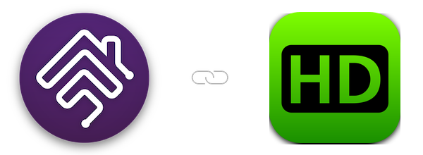

   

## homebridge-hdhomerun

Homebridge plugin to show SiliconDust HDHomeRun tuners and Channels DVR in Apple Home

 

### Plugin Information

- This plugin shows your [SiliconDust HDHomeRun](https://www.silicondust.com) tuners in Apple Home, with a live dashboard. The plugin:
  - finds your HDHomeRun tuners on the network by itself, and reads them locally - it never changes anything on the device
  - shows one **TV In Use** switch that is on while anything is watched or recorded, or a switch per tuner if you prefer
  - ignores channel surfing, so automations don't run twice when you flick through channels
  - adds a **Poor Reception** sensor, so the Home app can tell you when the signal drops
  - can show **estimated watts and kWh** on the TV In Use tile, over Matter (Homebridge `v2.3` or above)
  - works with [Channels DVR](https://getchannels.com) for recordings and online (M3U) channels, if you use it
  - adds a live dashboard of tuners, channels, recordings, reception and viewing statistics, as a tab in the Homebridge UI and at `http://<homebridge>:8588/`

### Prerequisites

- To use this plugin, you will need to already have:
  - [Node](https://nodejs.org): latest version of `v22`, `v24` or `v26` - any other major version is not supported.
  - [Homebridge](https://homebridge.io): `v1.11.4` or above, or `v2` - refer to link for more information and installation instructions.
  - For estimated watts in the Home app: Homebridge `v2.3` or above with Matter turned on, and iOS/tvOS `27` or above.

### Setup

- [Installation](https://github.com/homebridge-plugins/homebridge-hdhomerun/wiki/Installation)
- [Configuration](https://github.com/homebridge-plugins/homebridge-hdhomerun/wiki/Configuration)
- [Beta Version](https://github.com/homebridge-plugins/homebridge-hdhomerun/wiki/Beta-Version)
- [Node Version](https://github.com/homebridge-plugins/homebridge-hdhomerun/wiki/Node-Version)

### Features

- [Supported Devices](https://github.com/homebridge-plugins/homebridge-hdhomerun/wiki/Supported-Devices)
- [Apple Home and Matter](https://github.com/homebridge-plugins/homebridge-hdhomerun/wiki/Apple-Home-and-Matter)
- [Dashboard](https://github.com/homebridge-plugins/homebridge-hdhomerun/wiki/Dashboard)
- [Channels DVR](https://github.com/homebridge-plugins/homebridge-hdhomerun/wiki/Channels-DVR)

### Help/About

- [Common Errors](https://github.com/homebridge-plugins/homebridge-hdhomerun/wiki/Common-Errors)
- [Support Request](https://github.com/homebridge-plugins/homebridge-hdhomerun/issues/new/choose)
- [Changelog](https://github.com/homebridge-plugins/homebridge-hdhomerun/blob/latest/CHANGELOG.md)

### Credits

- To [@Wazza151](https://github.com/Wazza151): the original creator of this plugin.
- To the creators/contributors of [Homebridge](https://homebridge.io) who make this plugin possible.

### Disclaimer

- I am in no way affiliated with SiliconDust or Channels DVR and this plugin is a personal project that I maintain in my free time.
- Use this plugin entirely at your own risk - please see licence for more information.
