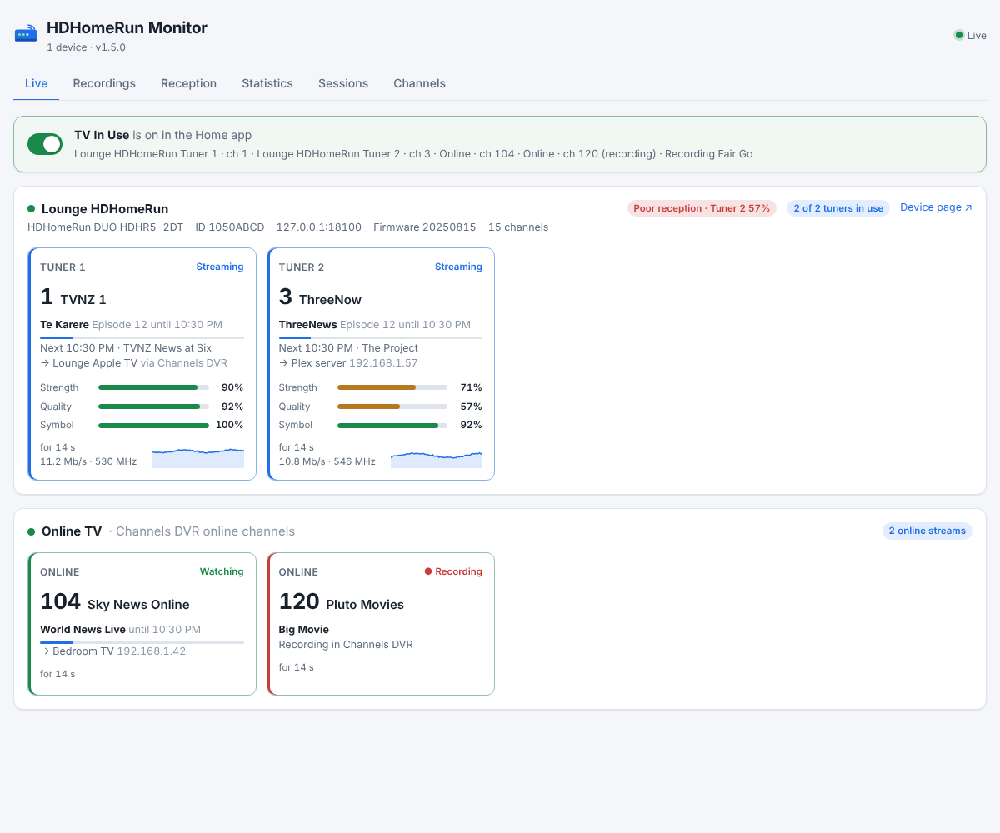
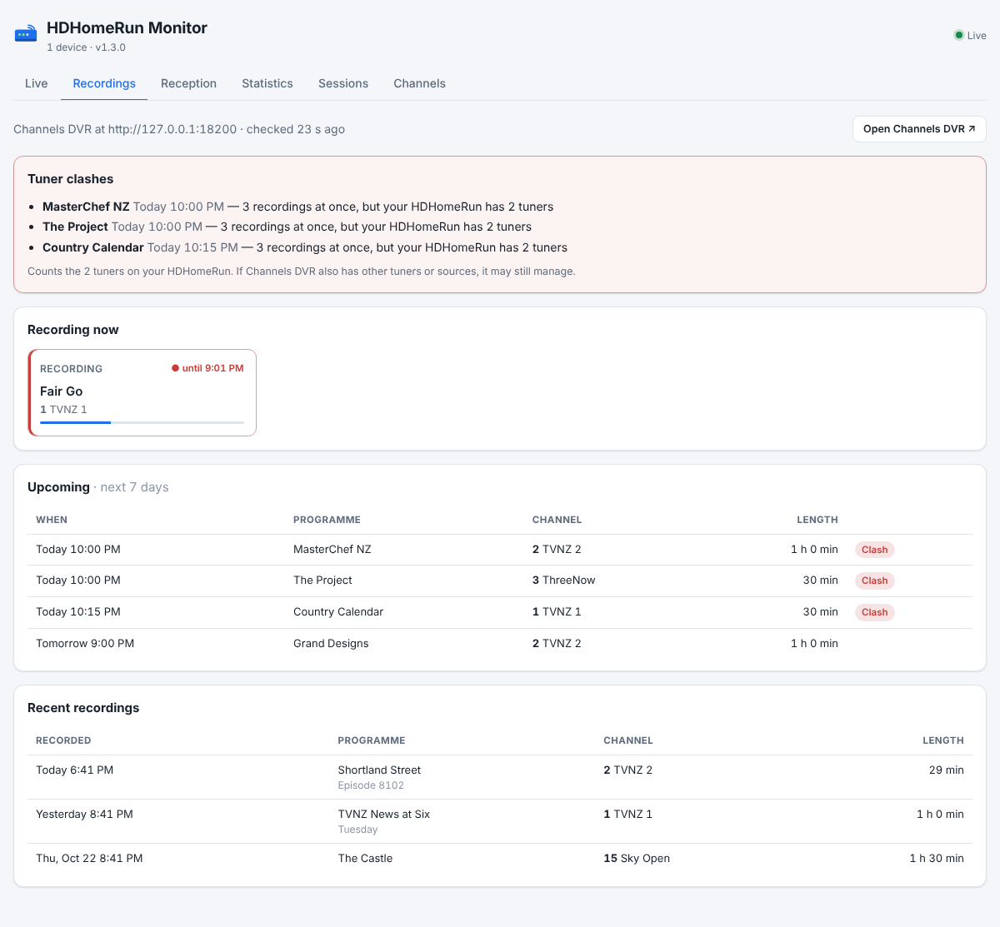
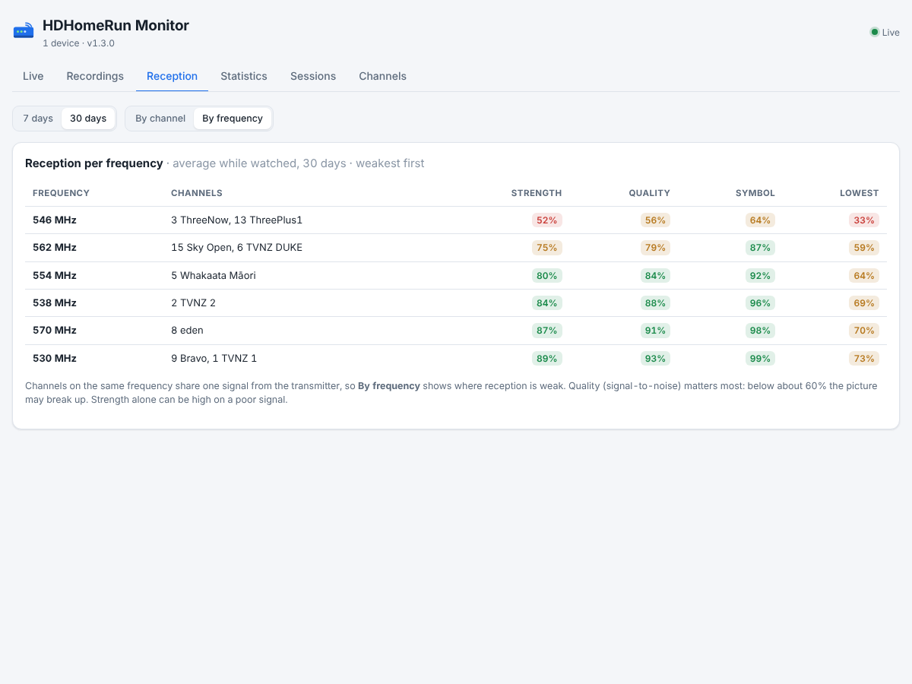
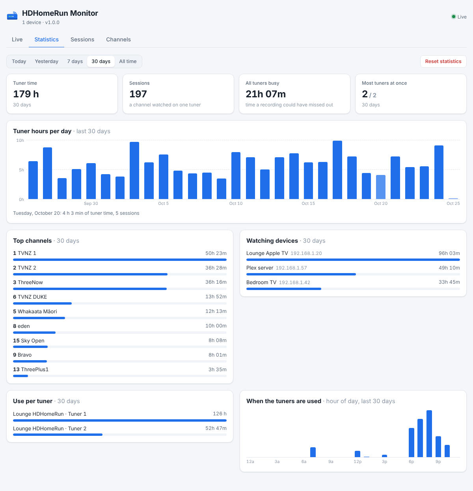

# homebridge-hdhomerun-monitor

Your **SiliconDust HDHomeRun** in the Apple Home app — a sensor per tuner that is occupied while it streams — with a live dashboard of what each tuner is watching, who is watching it, signal quality and viewing statistics. The dashboard is a tab in Homebridge Config UI X and a standalone page at **`http://<your Homebridge machine>:8588/`**.



## What you get

**In HomeKit**, by default, **one switch: TV In Use.** It is on while anything is being watched or recorded — an HDHomeRun tuner (watched directly or through Channels DVR), a Channels DVR online (M3U) channel, or a recording — and off once everything has stopped. It waits 30 seconds before turning on and 2 minutes before turning off, so channel surfing and the gap between programmes don't fire automations twice. Like every switch here it only reports: tapping it in the Home app changes nothing. Under **TV In Use switch** you can rename it, leave recordings out, change the delays, or show it as an occupancy sensor for Home app notifications. The dashboard's Live tab shows the switch and what is keeping it on.

**Watts on the tile (Matter).** On Homebridge 2.3 or later with Matter turned on for this plugin's bridge, TV In Use is published as a **Matter outlet** instead: the same on/off behaviour, plus its **estimated watts** on the Home app tile and its **kWh** counted up over time (shown by iOS/tvOS 27 and later; earlier versions show the outlet without watts). The HDHomeRun has no power meter, so the plugin estimates its draw: **3 W idle plus 1 W per busy tuner** by default, set per device to match a reading from a smart plug, with optional watts per online stream. To set it up:

1. In Homebridge, run the plugin as a child bridge (Plugins → HDHomeRun Monitor → ⋮ → Bridge Settings) and turn on **Enable Matter** for it. Keep HAP on: the Poor Reception sensor still uses it.
2. Restart Homebridge. The log shows `[Matter] "TV In Use" published`, and the bridge's Matter pairing code.
3. In the Home app, tap **+ → Add Accessory** and scan or enter that Matter code.

The Matter outlet replaces the HAP TV In Use switch, so automations on that switch need moving to the new one. Apple's Energy view lists only certified Matter devices on their own; bridged accessories count towards the home's total. Set **Apple Home connection** to **HomeKit only** to keep the plain switch.

**Matter only.** Set **Apple Home connection** to **Matter only** and nothing is published on HomeKit: everything goes over Matter, so one Matter pairing covers it all, and it can be shared with Google Home, Alexa or SmartThings too.

| | HomeKit | Matter only |
| --- | --- | --- |
| TV In Use | switch | outlet with estimated watts and kWh |
| Poor Reception | occupancy sensor | Matter occupancy sensor (the Home app may show it as a motion sensor; notifications work the same) |
| Online | contact sensor | Matter contact sensor |
| Separate switches: per tuner, In Use, All Busy, Online TV, per channel | switches | outlets; each HDHomeRun's watts are on its **In Use** outlet only, so the home's total isn't counted twice |

To use it: run the plugin as a child bridge with **Enable Matter** on and **HAP off**, restart, and add the bridge to the Home app with its Matter code. Without Matter (Homebridge older than 2.3, or Matter off for the bridge) the plugin uses HomeKit and the log says why. Changing the connection replaces the accessories, so add them to the Home app again and redo their automations.

Each HDHomeRun also gets an accessory for its **Poor Reception** sensor (and the Online contact sensor, if turned on).

**Separate switches** (setting **HomeKit switches → Separate switches**, `"homekitLayout": "separate"`) gives the detailed set instead. Each tuner shows as a **switch** that turns on while the tuner is streaming and off when it stops (or, with `sensorType: "occupancy"`, an occupancy sensor):

| Switch / sensor | On while | Default |
| --- | --- | --- |
| Tuner 1 … Tuner N | that tuner is streaming | on |
| *Name* In Use | any tuner is streaming | on |
| *Name* All Busy | every tuner is streaming — a recording would fail now | off |
| *Name* Online (contact sensor) | the device answers on the network | off |
| *Name* Poor Reception (occupancy sensor) | a streaming tuner's signal quality has stayed below 60% for 3 minutes | on |

**Channel surfing is ignored:** a switch turns on only after its tuner has streamed for 30 seconds, and off only after 2 minutes idle, so flicking through channels or the gap between programmes doesn't fire your automations twice. Both times can be changed per device (`onDelaySeconds`, `offDelaySeconds`; 0 for straight away).

**Poor Reception** is always an occupancy sensor, so the Home app can notify you: turn on its notifications in the sensor's settings. It catches an aerial knocked out of line or a storm. It clears once quality has been back above the level for a minute.

The switches only report. Tapping one in the Home app does nothing to the HDHomeRun; it flips straight back to what the tuner is doing, so an automation on "Tuner 1 turns on" only fires when the tuner really starts. Use them in automations ("when the Lounge HDHomeRun In Use turns on, dim the lights"). The switches are off while the device is unreachable.

Pick occupancy sensors instead if you want Home app notifications (the Home app notifies for sensors, not switches); they show a fault while the device is unreachable. Changing between the two replaces them in HomeKit, together with any automations on them.

**Online channels through Channels DVR** (separate switches). Channels DVR can also stream channels from a custom M3U source (or TV Everywhere), which never touch the HDHomeRun. The plugin reads what Channels DVR is streaming and adds a **Channels DVR** accessory:

| Switch | On while | Default |
| --- | --- | --- |
| *Online TV* In Use | any online channel is being watched | on |
| *Channel name and number* | that channel is watched through Channels DVR, from any source — one per channel you list | none |

They behave like the tuner switches: the same 30-second / 2-minute channel-surfing delays (set separately), report only, switches or occupancy sensors. Recordings don't turn them on unless you tick **Recordings turn the switches on too**. Watching an HDHomeRun channel through Channels DVR turns on the HDHomeRun's tuner switch, not the online one.

**On the dashboard:**

- **Live** — each tuner's channel with **what's on now and next** (from SiliconDust's guide, where it covers your area), the device watching it (named by you, or by its reverse DNS name), how long it has been on, signal strength / quality / symbol quality with a one-hour sparkline, bit rate and frequency; device model, firmware, and a badge when a firmware update is available.
- **Online TV** (on the Live tab) — each online channel being watched or recorded through Channels DVR: channel, programme now, which device is watching, the M3U source, how long, and the state of the HomeKit switches. HDHomeRun tuners used through Channels DVR show the device really watching, not the Channels DVR server; Sessions and Statistics record it the same way, and online channel time is counted separately from tuner time.
- **Recordings** — from **Channels DVR**: what's recording now, the next 7 days, recent recordings and failed ones, with a **clash warning** on any recording that needs more tuners than your HDHomeRun has (or every tuner, leaving none for live TV), and a warning when a recording is about to start while live TV is using the tuners it needs.
- **Reception** — signal strength, quality and symbol quality per channel over 7 or 30 days, weakest first, with the lowest reading and a 14-day trend; or **by frequency**, since channels on one frequency share a signal — the view to use when lining up an aerial.
- **Statistics** — tuner time, sessions, time with every tuner busy, and most tuners at once for today, yesterday, 7 days, 30 days or all time; tuner hours per day for 30 days; top channels; watching devices; use per tuner; and an hour-of-day profile.
- **Sessions** — each channel watched on a tuner: when, by which device, how long, and the average signal quality (hover for the lowest).
- **Channels** — the device's lineup with HD / favourite / DRM flags, which channels are on now, and how long each was watched in the last 30 days; links to the device's `.m3u` playlist.
- **Settings** (Config UI X only) — search the network for HDHomeRuns or test an address, add them with one click, and the normal settings form below.

The standalone page updates instantly over server-sent events and follows the system's light or dark mode; the Config UI tab follows Config UI's theme and refreshes every few seconds.







## Install

**In Homebridge Config UI X** (recommended):

1. Open the **Plugins** tab.
2. Search for **HDHomeRun Monitor** and click **Install**.
3. Restart Homebridge when asked.
4. Open the plugin's **Settings**. On the **Settings** tab, click **Search** to find your HDHomeRun, click **Add**, then **Save**, and restart Homebridge once more.

**From the command line:**

```sh
npm install -g homebridge-hdhomerun-monitor
```

or, on the official Homebridge images and hb-service installs:

```sh
hb-service add homebridge-hdhomerun-monitor
```

Then restart Homebridge. With no devices configured, the plugin finds HDHomeRuns on the network by itself.

Run the plugin as a **child bridge** if you like (Plugins → HDHomeRun Monitor → ⋮ → Bridge Settings): it keeps it separate from your other plugins.

## Configuration

```json
{
  "platform": "HDHomeRunMonitor",
  "name": "HDHomeRun Monitor",
  "devices": [
    { "name": "Lounge HDHomeRun", "host": "192.168.1.30", "deviceId": "1050ABCD", "sensorType": "switch", "tuners": [1, 2], "allBusySensor": true }
  ],
  "clients": [
    { "ip": "192.168.1.20", "name": "Lounge Apple TV" },
    { "ip": "192.168.1.57", "name": "Plex server" }
  ],
  "dashboard": { "enabled": true, "port": 8588, "host": "0.0.0.0" }
}
```

| Option | Default | |
| --- | --- | --- |
| `devices[].name` | device's own name | Name in HomeKit, the log and the dashboard. |
| `devices[].host` | — | IP address or host name. Leave out to find the device by `deviceId`. |
| `devices[].deviceId` | — | The 8-character ID on the device's label. Lets the plugin follow the device to a new address. |
| `homekitLayout` | `combined` | `combined`: one TV In Use switch. `separate`: the switches below per tuner, In Use, All Busy, Online TV and per channel. |
| `combined.name` | `TV In Use` | Name of the combined switch. |
| `combined.includeRecordings` | `true` | Recordings turn TV In Use on too. |
| `combined.sensorType` | `switch` | `switch` or `occupancy`. |
| `combined.onDelaySeconds` / `offDelaySeconds` | `30` / `120` | Channel-surfing delays for TV In Use. |
| `appleHome` | `matter` | `matter`: HomeKit, with TV In Use over Matter for its watts when Matter is on. `matterOnly`: everything over Matter. `homekit`: HomeKit only. |
| `energy.idleWatts` / `tunerWatts` | `3` / `1` | Estimated HDHomeRun draw: idle, and extra per busy tuner. Per device: `devices[].idleWatts`, `devices[].tunerWatts`. |
| `energy.onlineStreamWatts` | `0` | Extra watts per online stream through Channels DVR. |
| `energy.pricePerKwh` | — | Your power price, for the cost on the dashboard. |
| `devices[].homekit` | `true` | `false` to show the device only on the dashboard. |
| `devices[].sensorType` | `switch` | Separate switches: `switch` or `occupancy`, how the tuners show in HomeKit. |
| `devices[].tuners` | all | Which tuners to show, by number: `[1]` for Tuner 1 only, `[1, 3]` for Tuners 1 and 3. In the settings form, tick them under **HomeKit → Tuners to show**. Removing a tuner removes its switch from HomeKit, with any automations on it. In Use and All Busy still count every tuner. |
| `devices[].tunerSensors` / `anyTunerSensor` / `allBusySensor` / `onlineSensor` | `true` / `true` / `false` / `false` | Which switches or sensors to show (see above). |
| `devices[].onDelaySeconds` / `offDelaySeconds` | `30` / `120` | How long a tuner must stream before its switch turns on, and be idle before it turns off. |
| `devices[].poorReceptionSensor` | `true` | The Poor Reception sensor. |
| `devices[].poorReceptionThreshold` / `poorReceptionMinutes` | `60` / `3` | Signal quality (%) below which reception counts as poor, and for how long. |
| `guide` | `true` | Now and next from SiliconDust's programme guide. |
| `channelsDvr.url` | — | Your Channels DVR server, e.g. `http://192.168.1.5:8089`. Leave empty if it runs on the Homebridge machine (found at `127.0.0.1:8089`). |
| `channelsDvr.enabled` | `true` | Use Channels DVR for recordings and online channels. |
| `channelsDvr.homekit` | `true` | Separate switches: show the online-channel switches in HomeKit. |
| `channelsDvr.switchName` | `Online TV` | The "In Use" switch is called "*name* In Use". |
| `channelsDvr.onlineSwitch` | `true` | The "In Use" switch. |
| `channelsDvr.channelSwitches` | — | Channel numbers to give a switch each, e.g. `["104", "105"]`. |
| `channelsDvr.includeRecordings` | `false` | Recordings turn the online switches on too. |
| `channelsDvr.sensorType` | `switch` | `switch` or `occupancy`. |
| `channelsDvr.onDelaySeconds` / `offDelaySeconds` | `30` / `120` | Channel-surfing delays for the online switches. |
| `discovery` | `true` | Find HDHomeRuns on the network (UDP broadcast, every 10 minutes). Turn off to use only the listed devices. |
| `pollSeconds` | `5` | How often to read tuner status. |
| `clients[]` | — | Names for watching devices, by IP address. |
| `dashboard.enabled` / `port` / `host` | `true` / `8588` / `0.0.0.0` | The web dashboard. Use host `127.0.0.1` to keep it to the Homebridge machine (the Config UI tab still works). |
| `logSessions` | `true` | Log each channel started and stopped. |
| `keepDays` | `400` | How long to keep daily statistics. |

## How it works

The plugin reads the HDHomeRun's own HTTP API: `discover.json` (model, firmware, tuner count), `status.json` (per tuner: channel, client IP, signal) and `lineup.json` (channels). Older firmware without `status.json` is read over HDHomeRun's native control protocol on TCP 65001 instead (`/tunerN/status`, `/tunerN/vchannel`, `/tunerN/target`) — the same protocol `hdhomerun_config` uses. Discovery is HDHomeRun's UDP broadcast on port 65001. It never changes anything on the device.

Now and next come from SiliconDust's guide service (`api.hdhomerun.com`), asked with the device's own DeviceAuth key as the HDHomeRun app does; the key never appears on the dashboard. Recordings come from Channels DVR's read-only server API (`/api/v1/jobs`, `/api/v1/episodes`, `/api/v1/movies`), on your network only. Online channels come from Channels DVR's live activity (`/dvr`, checked as often as the tuners), whose session names say which source each stream uses (`…-stream-M3U-Online-…` for an M3U source called Online, the HDHomeRun's device ID for a tuner); channel names from `/api/v1/channels` and what's on from `/devices/ANY/guide/now`. A recording doesn't name its source, so a recording of a channel the HDHomeRun doesn't carry counts as online.

A device on another subnet or VLAN won't answer the broadcast: give its `host`.

Everything is kept in the Homebridge storage folder under `hdhomerun-monitor/`:

- `stats.json` — seconds per tuner, channel, client and hour, per local day
- `sessions.json` — the last 1000 sessions
- `history.json` — signal per tuner per minute, last 24 hours
- `reception.json` — signal per channel per day, last 60 days
- `energy.json` — estimated energy, total and per day
- `guide.json`, `channels.json` — the latest programme guide and Channels DVR schedule
- `state.json`, `lineup-<id>.json` — the latest state and channel lists, which the Config UI tab reads when the plugin is not running

**Reset statistics** on the Statistics tab (click twice) empties the statistics and sessions.

## Dashboard API

`GET /api/snapshot` (everything), `GET /api/state` (live devices and open sessions), `GET /api/events` (server-sent events, an `event: live` on every poll). Handy for your own widgets or Home Assistant's REST sensor.

The dashboard has no login; anyone on your network who can reach port 8588 can see it. Set `dashboard.host` to `127.0.0.1` if that matters to you.

## Requirements

Homebridge 1.8 or 2.x, Node.js 18 or later. Watts on TV In Use need Homebridge 2.3 or later with Matter on, and iOS/tvOS 27 or later. Works with HDHomeRun models that have the HTTP API (every current model, including the DVB-T DUO/QUATRO sold in New Zealand, and ATSC and CableCARD models).

## Development

```sh
npm test                     # end-to-end against a mock HDHomeRun
node test/mock-hdhomerun.js --auto   # a pretend tuner at 127.0.0.1:8080 that changes channels
```

## Licence

MIT
